## 줄기

### 추측 (출처를 읽기 전에, 2026-09-13)

- 어떤 문제 때문에 생겼나: "실제 무슨 작업을 했는지 커밋을 보고 알 수가 없어. 뒤죽박죽으로 많은 커밋들이 되어 있어서"
- 그 문제는 지금도 있나: "동일해. scoped-commit 스킬을 쓰는데 이 또한 너무 많은 커밋을 나누는 거 아닌가 싶기도 해."
- 그때의 대안은: "브랜치를 파고 작업을 하거나, 정말 검증된 것들만 커밋하는 방식?"
- 출발한 물음: "나는 커밋을 보면 굉장히 많은 커밋을 진행했어. 하지만 실제 이런 스킬을 운영하는 사람들의 커밋을 보면 커밋의 개수가 그리 많지 않아. 어떤 전략을 사용해서 커밋을 하길래 커밋이 많지 않은걸까?"

### 실제 기록에서 본 수 (2026-09-13 기준)

| | mattpocock/skills | cursor/plugins 의 pstack |
|---|---|---|
| main 의 커밋 수 | 459 | 86 |
| 그중 머지 커밋 | 103 | 0 |
| PR 하나 안의 브랜치 커밋 수 (최근 30 PR) | 1개 15건, 2개 7건, 3~5개 7건, 9개 1건 | 1~4개 |
| 저자 | Matt 422, 나머지는 에이전트 | lauren(poteto) 83, Cursor Agent 3 |

- Matt 의 첫 커밋들: `Initial commit`, `Updates`, `Added migrate to shoehorn script`, `Updates`, `Updates`, `Updates`. PR 없이 main 에 바로 올린 커밋이 최근까지 이어진다.
- Matt 의 CLAUDE.md 와 AGENTS.md 에는 커밋 단위·개수 규칙이 없다. 있는 것은 `.changeset/` 뿐.
- pstack 의 PR #366: 브랜치에는 커밋 넷(feat, docs, refactor, fix), main 에는 하나(`5bf2b15`). 그 하나의 본문 안에 넷의 메시지가 `* ` 로 이어 붙어 있다.

### 출처 대목 (원문 그대로. 한글은 번역)

모두 cursor/plugins 의 `pstack/skills/poteto-mode/playbooks/` 에 있고 저자는 lauren(poteto). 클론은 `lab/repos/cursor-plugins/`.

**opening-a-pr.md 7번 줄**

> Commit liberally. Rebase into small, ordered commits before opening PRs. Each commit is a future PR: landable, ordered to tell the story. Amend when the fix belongs in a just-made commit. New commit when separable.
>
> 커밋은 아낌없이 한다. PR 을 열기 전에 rebase 해서 작고 순서가 있는 커밋들로 다시 짠다. 커밋 하나하나가 나중에 PR 하나가 될 수 있는 것이다. 혼자 올려도 되고, 이야기가 읽히는 순서로 놓여 있다. 고친 내용이 방금 만든 커밋에 속하면 amend 로 그 커밋에 넣는다. 떼어낼 수 있는 것이면 새 커밋으로 만든다.

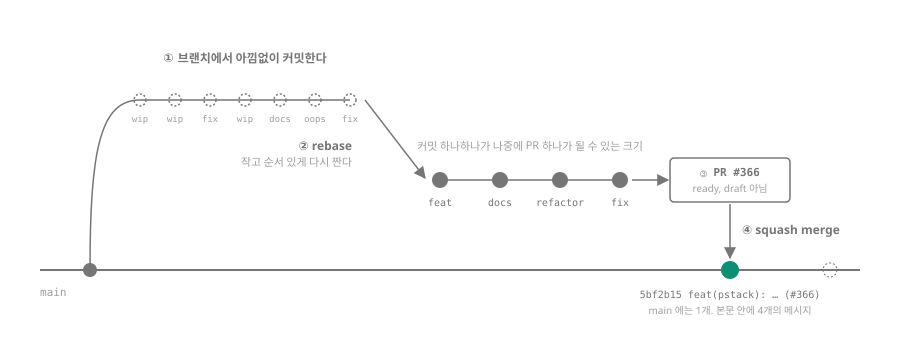

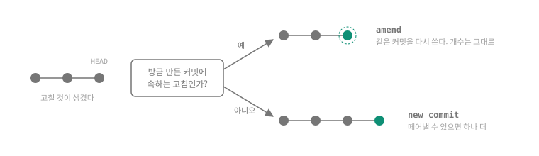

**opening-a-pr.md 13번 줄**

> The PR body is a briefing, not the lab notebook. A reviewer who has the diff should learn why the change exists, what is out of scope, and how you proved the change works. The squash commit body is the PR body. If the body would make the squash commit longer than about 40 lines, cut the body.
>
> PR 본문은 브리핑이지 실험 노트가 아니다. diff 를 앞에 둔 리뷰어가 왜 이 변경이 있는지, 무엇이 범위 밖인지, 이 변경이 되는 걸 어떻게 증명했는지를 알 수 있어야 한다. squash 커밋의 본문이 곧 PR 본문이다. 본문 때문에 squash 커밋이 40줄쯤을 넘으면 본문을 줄인다.

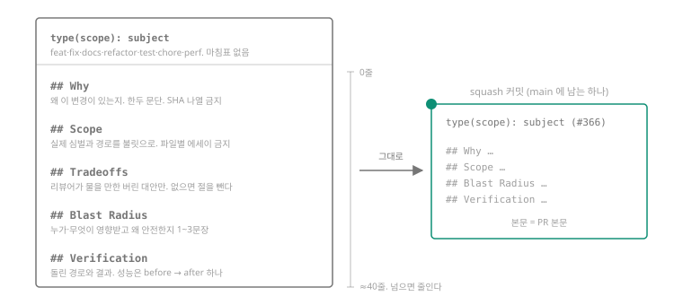

**opening-a-pr.md 27번 줄**

> Prefer five narrow PRs to one large PR. A stack is a base-branch chain. The root PR targets trunk. Each child branch rebases onto its parent's exact tip and its PR targets the parent branch.
>
> 큰 PR 하나보다 좁은 PR 다섯을 택한다. stack 이란 base 브랜치를 사슬로 이은 것이다. 맨 아래 PR 은 main 을 향한다. 그 위의 브랜치는 각각 바로 아래 브랜치의 끝 커밋 위로 rebase 하고, 그 PR 은 바로 아래 브랜치를 향한다.

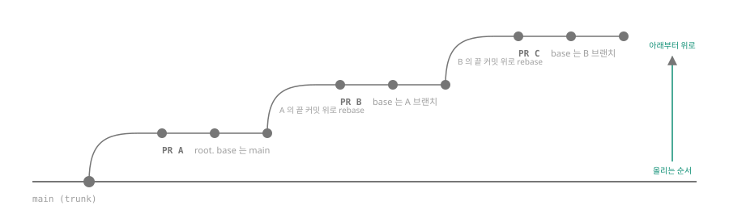

**다른 플레이북의 커밋 줄**

> (bug-fix.md 11번 줄) Stage the commits so the failing repro lands before the fix in git history.
> 실패를 재현하는 커밋이 고치는 커밋보다 먼저 git 기록에 들어가도록 커밋을 배치한다.
>
> (refactoring.md 14번 줄) Rebase into small ordered commits. A subtraction commit, then the reshape, then any follow-on cleanup. Shape them with the sequence-verifiable-units principle skill, so each behavior-preserving slice stays green before the next.
> 작고 순서 있는 커밋으로 rebase 한다. 먼저 빼는 커밋, 그다음 모양 바꾸는 커밋, 그다음 뒤따르는 정리. 검증 가능한 단위로 잇는다는 원칙대로 모양을 잡아서, 동작을 바꾸지 않는 조각 하나하나가 다음으로 가기 전에 테스트를 통과한 상태로 있게 한다.
>
> (hillclimb.md 15번 줄) One commit per accepted fix, staging only the files you changed (`git add <files>`, never `-A`).
> 받아들인 고침 하나에 커밋 하나. 내가 바꾼 파일만 stage 한다. `git add -A` 는 쓰지 않는다.
>
> (pause-safely.md 7번 줄) Commit uncommitted edits as one clear `wip:` commit on the current branch so nothing is lost. If the tree is broken, say so in the commit body in one line.
> 커밋 안 된 편집은 지금 브랜치에 `wip:` 커밋 하나로 분명히 남겨 아무것도 잃지 않게 한다. 트리가 깨졌으면 커밋 본문 한 줄로 그렇다고 말한다.

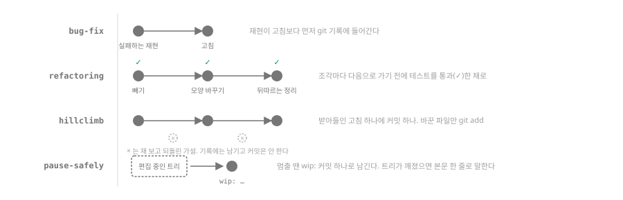

**왜 (pstack/README.md 첫머리)**

> there's a growing sense that ai writes too much slop code. i agree. i don't want to ship like a team of twenty slop artists. throughput without quality is not a goal i aspire to. if you want to go fast, go deep first.
>
> AI 가 쓰레기 코드를 너무 많이 쓴다는 느낌이 퍼지고 있다. 나도 동의한다. 쓰레기를 찍어내는 스무 명짜리 팀처럼 내보내고 싶지 않다. 품질 없는 처리량은 내가 바라는 목표가 아니다. 빨리 가고 싶으면 먼저 깊이 가라.

**Matt 쪽에서 커밋 크기에 가장 가까운 문장 (docs/engineering/to-tickets.md 59번 줄)**

> Over-decomposition is the most reported friction on this skill, and it is consistent across practitioners: the model defaults to atomic units and loses the grouping that would make them meaningful.
>
> 너무 잘게 쪼개는 것이 이 스킬에서 가장 많이 보고되는 불편이고, 쓰는 사람마다 같다. 모델은 기본적으로 원자 단위로 나누고, 그것들을 의미 있게 만들어 줄 묶음을 잃는다.

### 견줌 (사용자의 낱말)

- 읽고 나서 한 말 (2026-09-15): "이해했어. pstack 명세가 굉장히 명확하게 각 경우마다 잘 남겨져 있다고 생각해."
- 희석된 것: (아직 안 적음. 추측 중 원문과 어긋나거나 이유가 달라 보이는 것)
- 남은 것: (아직 안 적음. 추측 중 원문이 그대로 받쳐 주는 것)

## 과제

- 하려는 것: 이 lab-notes 저장소에서 다음 작업 하나를 브랜치에서 자유롭게 커밋한 뒤, PR 열기 전에 작고 순서 있는 커밋으로 다시 짜고, PR 본문을 브리핑으로 써서 main 에 얹는다
- 사용자의 원래 말: "작업 방식을 보고 일하는 방식을 이해하고 배우고 싶어. 왜 그렇게 하는지까지 알면 좋겠어." 이것은 목표라 점검 장치가 되지 않아 위 문장을 제안했고, 2026-09-15 "이해했어"로 받았다.

## 지도

| # | 기제 | 숨은 상태 | 관측할 것 | 상태 |
|---|---|---|---|---|
| 1 | main 의 커밋 수는 브랜치의 커밋 수와 무관하다. 사이에서 rebase 가 한 번, squash 가 또 한 번 수를 줄인다 | 브랜치의 커밋 목록과 main 의 커밋 목록이 서로 다른 것이라는 사실, squash 커밋의 본문 | 브랜치 `git log` 와 squash merge 뒤 main `git log` 의 차이, main 커밋 본문 | 도는 중 |
| 2 | stack: PR 의 base 가 main 이 아니라 다른 PR 의 브랜치일 때 무엇이 달라지는가 | 각 PR 의 base ref, 아래 PR 이 merge 된 뒤 위 PR 의 diff | PR 의 base 와 diff 범위 | 안 함 |
| 3 | issue 와 PR 의 연결: issue 가 어디서 나와 어떻게 닫히는가 (사용자 요청, 2026-09-15) | issue 번호와 PR 본문의 연결 키워드 | issue 상태 변화 | 안 함 |

## 회차
### 1. 기제 1 — 2026-09-15
- 실험: `lab/01-branch-cycle.sh`. 임시 저장소에서 main 에 커밋 1개, feature 브랜치에 wip 커밋 7개(wip·wip·fix·wip·docs·oops·fix). ① 브랜치 로그를 찍고, ② rebase 로 4개(feat·docs·refactor·fix)로 다시 짠 뒤 원래 7개 커밋 객체가 남아 있는지·어느 브랜치에 속하는지 찍고, ③④ GitHub 기본 squash merge 를 손으로 흉내 내어 main 에 얹은 뒤 main 의 커밋 수·맨 위 커밋 본문·feature 와 main 의 차이를 찍는다.
- 없으면: (아직)
- 예측: "모르겠어. 너가 설명한 git의 기능부터 자세히 설명해줘." → 풀이된 예제 먼저 보여주고 변형으로 다시 받기로
- 예제 (git 의 구조, 2026-09-15): 커밋은 못 고치는 물건이고 브랜치는 커밋 하나를 가리키는 이름표다. amend·rebase·squash 는 전부 "새 물건을 만들고 이름표를 옮기는 일". 그림 여섯 장: `lab/diagrams/g1`~`g6`, 모은 페이지 `lab/diagrams/git-objects-and-labels.html`.

  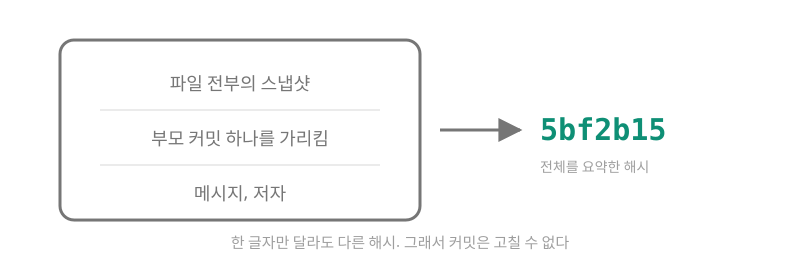

  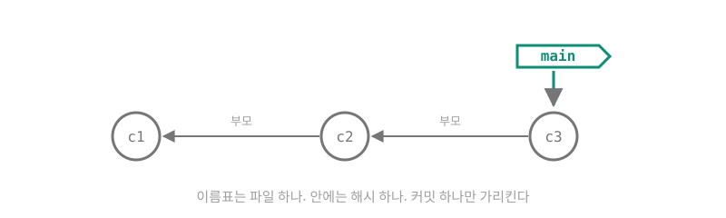

  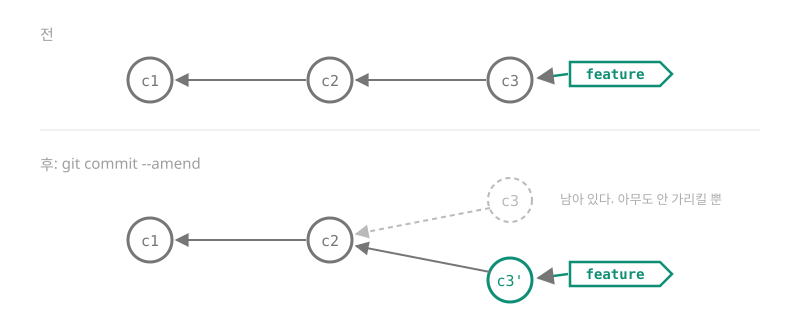

  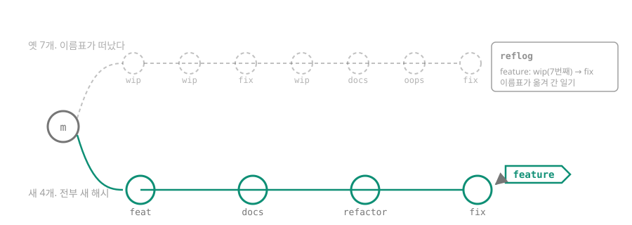

  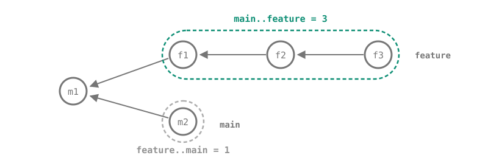

  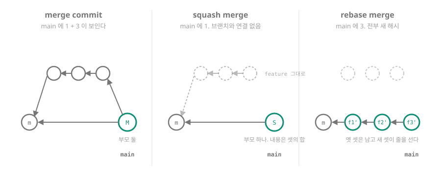

- 변형 예측: "amend를 하면 새로운 커밋 해시가 만들어지니까 모르지 않을까?" → `branch --contains` 는 빈 줄 · 낮음
- 변형 결과: 맞음. `branch --contains w1` → 빈 줄. 그런데 `cat-file -t w1` → commit, `git show w1` → 나옴, reflog 에 `feature@{1}: commit: wip` 남음. w1 과 새 커밋의 부모가 같음(형제). `log --all` 에는 w1 이 안 보임. 즉 이름표는 모르지만 저장소는 안다
- 예측 (본 실험, 2026-09-15): main 의 커밋 수 "squash merge는 1개만 늘어나서 2개" · 확신 미기재. `main..feature`·`feature..main` 은 "모르겠어. 무엇을 말하는건지" → `A..B` 풀이 예제(그림 5)를 보이고 squash 뒤 모양을 글로 그려 세어 보게 함
- 예측 (이어서): 닿는 것 "feature는 4개의 커밋. main은 1개의 squash merge 커밋만". 차이 "main..feature는 4개, feature..main은 1개."
- 결과: 예측대로. ① feature 7개 → ② rebase 뒤 4개(전부 새 해시). 옛 7개는 `cat-file -t` 전부 commit, `branch --contains` 전부 빈 줄, reflog 에 `feature@{1}: commit: fix` … 남음. ④ squash 뒤 main 2개(seed + `feat(lab): add feature (#1)`), 본문에 4개 메시지가 `* ` 로 붙음. `main..feature` 4, `feature..main` 1. `log --graph --all` 에서 S 와 fix 가 서로 다른 가지로 갈라져 있음. 짚은 것: 닿는 것을 셀 때 seed(m)가 양쪽에 다 있어서 빠진다는 점은 사용자가 말하지 않았지만 차이는 맞게 셌다
- 설명: "squash merge는 1개로 압축하는 걸로 알고 있어."
- 되물음: "압축해서 생긴 그 1개는 어디에 생기고, 브랜치에 있던 4개는 어떻게 되는가" → "사라지지 않아? 그래서 복구하기 힘들다고 들었던거 같아." (출력과 어긋남: squash 직후 `main..feature` = 4, feature 이름표가 그대로 4개를 가리킴) · "main 의 S 와 feature 의 4개는 어떤 관계인가. 부모로 이어져 있는가. 복구하기 힘들다는 말은 어느 상황인가" → "아 그러면 브랜치는 남아 있는데, 커밋이 될 때 1개만 남는거야? 그렇게 되면 일반 merge랑 다를게 없지 않아?" → 빼 보는 변형(merge commit)을 돌려 나란히 보임 (`lab/01b-merge-vs-squash.sh`): merge commit 은 main 6개, 맨 위 커밋의 부모 2개, `main..feature` 0, feature 브랜치를 지워도 main 에서 fix 커밋에 닿음. squash 는 main 2개, 부모 1개, `main..feature` 4, 브랜치를 지우면 main 에서 fix 커밋에 안 닿음(객체는 남고 reflog 1건) · 셋째 되물음 "그래서 둘의 차이는 무엇인가. 한 문장으로" → 답 대신 "자세히 깊게 설명해줘" (2026-09-17). 되물음 멈춤
- 판정: 구멍 — "브랜치는 남아 있는데, 커밋이 될 때 1개만 남는거야?"에서 숨은 상태의 절반(브랜치 커밋은 남고 main 에 새 커밋 하나)은 나왔으나, 그 하나의 부모가 seed 하나뿐이라 main 에서 4개로 가는 화살표가 없다는 것과, 그래서 브랜치를 지우면 main 이 4개를 못 붙든다는 것(없으면 깨지는 것)이 안 나왔다. 오개념 하나: "squash 하면 커밋이 사라진다"는 GitHub 이 squash 뒤 브랜치를 자동 삭제하는 화면에서 온 것으로 보임
- 모르겠다: "squash merge 와 일반 merge 의 차이는 무엇인가" (부모 화살표의 수와 닿음의 차이)
- 설명 (되물음 멈춘 뒤, 2026-09-17): 차이는 새 커밋의 부모 화살표가 둘(merge commit)이냐 하나(squash)냐. 둘이면 main 에서 브랜치 커밋에 닿고, 하나면 못 닿는다. 브랜치 이름표를 지우면 squash 쪽 4개는 어떤 이름표에도 안 걸린 채 남는다(물건은 있음). "복구하기 힘들다"는 그 뒤 reflog 만료(닿지 않는 것 기본 30일)와 gc 이후의 일. GitHub 은 refs/pull/N/head 로 PR 커밋을 계속 붙든다. squash 는 맞바꿈: main 한 줄 = PR 하나를 얻고 PR 안 커밋 단위 bisect·blame 을 잃는다. poteto 는 잃는 정밀함을 PR 을 작게 쪼개서 되찾는다. 그림 `lab/diagrams/g7`~`g11`, 페이지 `squash-vs-merge.html`

  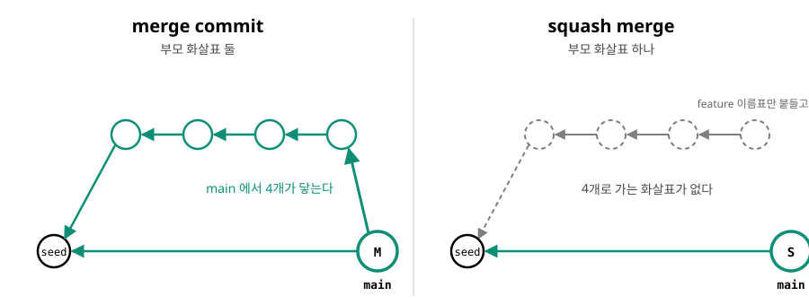

  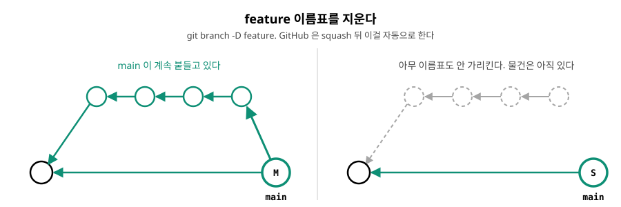

  

  

  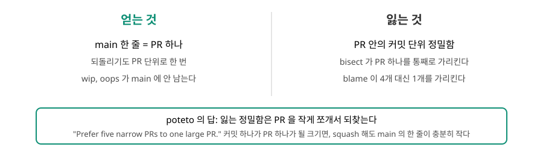

- 변형 물음 (예측 다시 받기):- 변형 물음 (예측 다시 받기): feature 에 커밋 w1 하나뿐일 때 amend 를 한 번 하면, `git cat-file -t <w1>` 은 commit 인가 오류인가, `git branch --contains <w1>` 은 feature 인가 빈 줄인가. 그다음 squash 뒤 main 의 커밋 수와 `main..feature`·`feature..main`.
